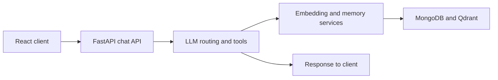

<div align="center">
  

  <p>
    
    
    
    <a href="LICENSE"></a>
  </p>
</div>

## 💡 What it does

Ideator is an AI-assisted ideation app. A user can explore a project direction through a chat interface; the backend combines model calls, embeddings, stored idea context, and external data integrations to help refine the concept and check for nearby ideas.

<p align="center"></p>

## 🧠 Request path



## 🧰 Stack

| Area | Tools |
|---|---|
| Client | React 19, Vite, Mantine, Tabler Icons |
| API | Python 3.12, FastAPI, Uvicorn |
| Persistence/cache | MongoDB, Redis |
| Retrieval | Qdrant, sentence-transformers |
| Models | Provider routing configured in `backend/config/llm_providers.yaml` |

## 🚀 Run locally

```bash
git clone https://github.com/ChristopherJoshy/ideator.git
cd ideator/backend
python -m venv .venv
# Windows: .venv\Scripts\Activate.ps1
# macOS/Linux: source .venv/bin/activate
pip install -r requirements.txt
uvicorn main:app --reload
```

In another terminal, start the frontend:

```bash
cd ideator/frontend
npm install
npm run dev
```

Set the model provider, MongoDB, Redis, and Qdrant configuration in a local environment file. Provider credentials are not included. The frontend and backend are separate services.

## 🗂️ Layout

```text
backend/   API, model routing, memory, embeddings and data services
frontend/  React interface and chat flow
```

## 📄 License

MIT. See [`LICENSE`](LICENSE).